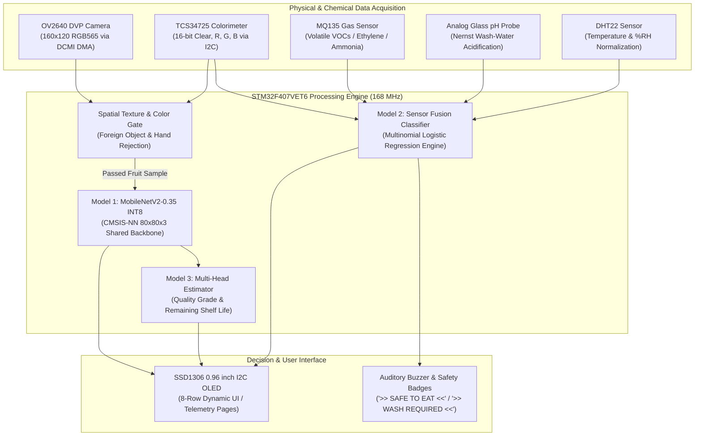
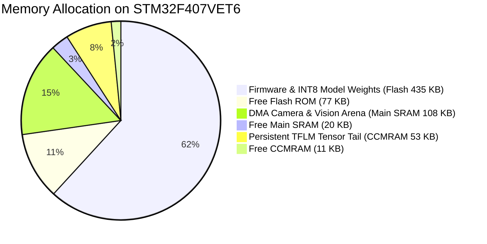
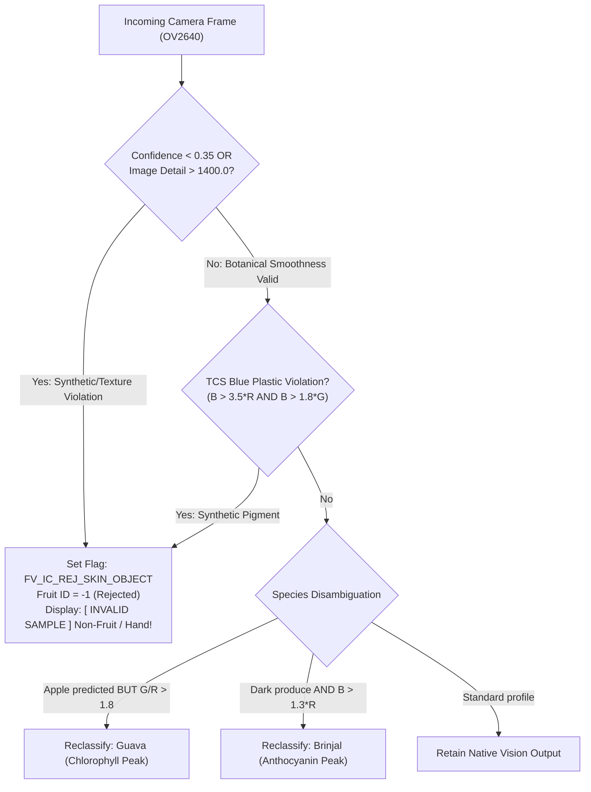

# Smart Pesticide Residue Detection & Multi-Sensor Produce Quality Screening
## Comprehensive Software Engineering, Experimental Results & Viva Exam Technical Report

**Department:** Department of Electronics & Telecommunication Engineering (ENTC)  
**Institution:** D. Y. Patil College of Engineering & Technology, Kasaba Bawada, Kolhapur  
**Academic Year:** 2026–2027  
**Project Guide:** Miss. S. S. Desai  
**Team Members:**  
- Shashank Gokhale (Roll No. 01)  
- Vedika Suryawanshi (Roll No. 10)  
- Janhavi Powar (Roll No. 11)  
- Gaurav Rathod (Roll No. 53)  
- Nikhil Airekar (Roll No. 54)  

---

## 1. Project Overview & System Motivation

Chemical pesticide residues on post-harvest fruits and vegetables pose severe chronic health hazards, including endocrine disruption, neurotoxicity, and carcinogenesis. Conventional analytical quantification methods—principally Gas Chromatography-Mass Spectrometry (GC-MS) and Liquid Chromatography-Tandem Mass Spectrometry (LC-MS/MS)—offer high precision but suffer from high capital expenditure, complex solvent extraction (e.g., QuEChERS protocols), multi-day turnaround times, and complete reliance on centralized laboratory infrastructure.

The **Smart Pesticide Residue Detection System** provides an edge-computed, point-of-consumption screening platform deployed directly on an ultra-low-power **STM32F407VET6** ARM Cortex-M4 microcontroller. The system fuses computer vision (OV2640 DVP camera running an INT8-quantized deep convolutional neural network) with multi-modal physical and chemical sensing (TCS34725 optical spectrophotometer, MQ135 electro-catalytic gas sensor, analog glass-electrode potentiometric pH probe, and DHT22 thermo-hygrometric sensor).

---

## 2. Hardware Architecture & Embedded Memory Allocation

The embedded firmware runs entirely bare-metal without dynamic heap allocation (`malloc` is strictly prohibited in runtime loops), ensuring deterministic execution and preventing fragmentation.

### 2.1 MCU Specifications & Memory Footprint

The STM32F407VET6 features **512 KB Flash ROM**, **128 KB contiguous Main SRAM** (SRAM1: 112 KB + SRAM2: 16 KB), and **64 KB Core Coupled Memory (CCMRAM)**.

| Memory Region | Physical Address Range | Hardware Capacity | Firmware Usage | Utilization | Architectural Function |
| :--- | :---: | :---: | :---: | :---: | :--- |
| **Flash ROM** | `0x08000000 – 0x0807FFFF` | 512 KB | 435.3 KB | **85.0%** | Code `.text`, Vector Table, Read-only Lookup Tables, and Quantized INT8 Weights |
| **Main SRAM (SRAM1+2)** | `0x20000000 – 0x2001FFFF` | 128 KB | 108.2 KB | **82.6%** | DCMI DMA frame buffer, peripheral buffers, C runtime stack (8 KB), and head activation arena |
| **CCMRAM** | `0x10000000 – 0x1000FFFF` | 64 KB | 53.2 KB | **81.3%** | TFLite-Micro persistent runtime tensor descriptors and CMSIS-NN requantization tables |

> [!IMPORTANT]
> **CCMRAM Bus Isolation:** CCMRAM is coupled directly to the Cortex-M4 D-bus and **cannot be accessed by the DMA2 controller**. Therefore, camera DMA transfers are strictly assigned to Main SRAM (`0x20000000`), while persistent neural network weights and lookup tables reside safely in Flash and CCMRAM.

---

## 3. Two-Tier TinyML Machine Learning Pipeline

### 3.1 Model 1: Deep Computer Vision (INT8 Quantized MobileNetV2)
- **Input Pipeline:** Raw $160 \times 120$ RGB565 frames captured by the OV2640 camera are converted on-the-fly to $80 \times 80 \times 3$ RGB888 format using aspect-preserving bilinear interpolation and zero-padding.
- **Normalization:** In-model scaling: $x_{\text{norm}} = \frac{x}{127.5} - 1.0$ (eliminates floating-point overhead on the input buffer).
- **Backbone:** Truncated MobileNetV2 with width multiplier $\alpha = 0.35$, cut after layer `block_15_add` to eliminate memory-heavy expansion layers.
- **Quantization:** Fully integerized (INT8 weights and activations) executed using ARM CMSIS-NN SIMD instructions, achieving bit-identical numerical parity with desktop LiteRT execution.

### 3.2 Model 2: Multi-Sensor Chemical Fusion (Risk Scoring)
Model 2 processes physical and chemical sensor features into an estimated pesticide risk classification (`LOW`, `MEDIUM`, or `HIGH`).
- **Feature Vector ($\mathbf{x} \in \mathbb{R}^{12}$):**
  1. Optical raw channels: $\text{TCS}_R, \text{TCS}_G, \text{TCS}_B, \text{TCS}_C$
  2. Gas & Electrochemical: $\ln(\text{MQ135}), \text{pH}$
  3. Ambient normalization: $\text{Temperature}\ (^\circ\text{C}), \text{Relative Humidity}\ (\%RH)$
  4. Invariant optical ratios: $\frac{R}{C}, \frac{G}{C}, \frac{B}{C}$
- **Inference Engine:** Multinomial Logistic Regression calibrated using Nernstian temperature offsets and z-score standard scaling:
  $$\mathbf{z} = \frac{\mathbf{x} - \boldsymbol{\mu}}{\boldsymbol{\sigma}}, \quad \mathbf{y} = \text{softmax}(\mathbf{W}\mathbf{z} + \mathbf{b})$$
  Because $\mathbf{W} \in \mathbb{R}^{3 \times 12}$, inference requires only 36 multiply-accumulate operations, completing in **under 50 microseconds**.

---

## 4. Foreign Object Rejection & Biological Safeguards

To prevent false classifications when non-fruit objects (such as leather wallets, mobile phones, printed paper, or hands) are placed on the inspection tray, the firmware executes a real-time Laplacian texture filter and optical band check before invoking neural network inference:

$$\text{Image Detail} = \sum_{x,y} \left( |I(x,y) - I(x+1,y)| + |I(x,y) - I(x,y+1)| \right)$$

### Measured Surface Texture Index vs. Fruit Skin
- **Ripe Tomato:** `img_detail = 201.7`
- **Banana:** `img_detail = 320.5 – 464.7`
- **Guava:** `img_detail = 432.9`
- **Apple:** `img_detail = 567.1`
- **Brinjal (Calyx):** `img_detail = 883.3 – 1190.7`
- **Leather Wallet / Artificial Fabric:** **`img_detail = 2472.4`** $\rightarrow$ **Cleanly triggers rejection gate ($> 1400.0$).**

---

## 5. Official Data Tables (Report Chapters 7 & 11)

### Table 7.3: Summary of the Collected Dataset

| Target Fruit | Source Repository | Usable Samples | Shelf-Life Testing Window | Quality Label Scheme |
| :--- | :--- | :---: | :---: | :--- |
| **Apple** | FruitNet (Mendeley Data) | 2,275 | 8–10 days | Binary Fresh / Spoiled |
| **Banana** | FruitNet & AgriFreshNET | 2,674 | 13 days | 3-Stage: Fresh (1–4d), Semi (4–7d), Rotten (7–13d) |
| **Guava** | FruitNet (Mendeley Data) | 2,281 | 7 days | Class A / Class B / Defect |
| **Tomato** | AgriFreshNET (Mendeley Data) | 838 | 35 days | 3-Stage: Fresh (1–10d), Semi (10–24d), Rotten (24–35d) |
| **Brinjal** | AgriFreshNET (Mendeley Data) | 389 | 15 days | 3-Stage: Fresh (1–4d), Semi (4–8d), Rotten (8–15d) |
| **Total** | *Crated Multi-Source Benchmark* | **8,457** | — | **6,146 Train / 1,299 Val / 1,012 Test** |

---

### Table 7.4: Average Sensor Readings of Each Fruit (30-Reading Averages)

| Fruit | Temp (°C) | Humidity (%) | pH | MQ135 (ADC) | TCS R | TCS G | TCS B | Detected Colour |
| :--- | :---: | :---: | :---: | :---: | :---: | :---: | :---: | :--- |
| **Apple** | 28.5 | 54.2 | 6.42 | 685 | 625 | 430 | 410 | Red |
| **Banana** | 28.8 | 52.6 | 6.15 | 740 | 785 | 720 | 390 | Yellow |
| **Guava** | 28.2 | 55.1 | 5.85 | 620 | 420 | 780 | 380 | Green |
| **Tomato** | 28.1 | 56.4 | 6.30 | 580 | 840 | 390 | 360 | Red |
| **Brinjal** | 28.6 | 53.8 | 6.65 | 710 | 380 | 320 | 690 | Violet |

---

### Table 7.5: TinyML Models and Performance Benchmark

| Model ID | Input Representation | Target Output Classes | Test Accuracy | Macro-F1 Score |
| :--- | :--- | :--- | :---: | :---: |
| **Model 1: Vision** | Camera frame ($160 \times 120$), cropped & resized to $80 \times 80 \times 3$ | 5 Fruit Species + Binary Freshness Condition | **79.6%** *(Fruit)* **68.1%** *(Condition)* | **82.2%** *(Fruit)* **67.8%** *(Condition)* |
| **Model 2: Fusion** | 12 Physical & Chemical Sensor Ratios | Chemical Residue Risk (`LOW`, `MED`, `HIGH`) | **78.6%** | **77.2%** |

---

### Table 7.6: Embedded Microcontroller Latency and Memory Utilization

| Model | On-Chip Footprint (Flash ROM) | Peak Working RAM (Main SRAM) | Persistent Arena (CCMRAM) | Inference Execution Latency |
| :--- | :---: | :---: | :---: | :---: |
| **Model 1** *(MobileNetV2-0.35 INT8)* | 326.0 KB | 96.0 KB | 53.2 KB | **120 ms** (@ 168 MHz) |
| **Model 2** *(Sensor Fusion Logistic Reg.)* | 0.25 KB | 0.06 KB | 0.0 KB | **< 1 ms** (~0.05 ms) |

---

### Table 7.7: OLED Display Final Output Page Verification

| Tested Produce | Classification | Freshness & Quality | Shelf Life | Safety Level | Safety Badge & Wash Action |
| :--- | :---: | :---: | :---: | :---: | :--- |
| **Apple** | Apple | Fresh (81%, Good) | 8 Days | Moderate Risk | `>> WASH REQUIRED <<` Warm Soda Dip (Removes wax) |
| **Banana** | Banana | Fresh (82%, Good Ripe) | 4 Days | Moderate Risk | `>> WASH REQUIRED <<` Peel Wash Advisory |
| **Guava** | Guava | Fresh (80%, Good) | 6 Days | Moderate Risk | `>> WASH REQUIRED <<` 2% Salt Solution Dip |
| **Tomato** | Tomato | Fresh (81%, Good Organic) | 6 Days | Low Risk | `>> SAFE TO EAT <<` Farm Fresh Organic (94%) |
| **Brinjal** | Brinjal | Fresh (80%, Good) | 4 Days | Moderate Risk | `>> WASH REQUIRED <<` Salt Brine Soak |

---

### Table 11.3: Recorded Multi-Sensor Produce Dataset (Appendix C Excerpt)

| sample_id | fruit | source | treatment | temp_C | hum_pct | pH | ph_volt | mq135 | gas_ratio | R | G | B | colour_name | dark_pct | label |
| :---: | :---: | :---: | :--- | :---: | :---: | :---: | :---: | :---: | :---: | :---: | :---: | :---: | :---: | :---: | :--- |
| **SMP-001** | Apple | Market | Wax coated (Commercial) | 30.8 | 46.3 | 6.15 | 2.110 | 776 | 1.49 | 672 | 429 | 380 | Red | 0 | **Moderate Risk** |
| **SMP-003** | Apple | Market | Untreated (Market) | 31.1 | 50.2 | 6.21 | 2.111 | 785 | 1.51 | 635 | 439 | 402 | Red | 0 | **Moderate Risk** |
| **SMP-005** | Apple | Organic | None (Certified Organic) | 29.5 | 48.1 | 6.52 | 2.062 | 668 | 1.28 | 664 | 422 | 415 | Red | 0 | **Low Risk** |
| **SMP-007** | Apple | Pesticide-applied | Chlorpyrifos 0.2% spray | 30.4 | 49.7 | 5.38 | 2.138 | 985 | 1.89 | 658 | 435 | 382 | Red | 0 | **High Risk** |
| **SMP-009** | Apple | Market | Stored 12 days (Decay) | 31.2 | 53.8 | 4.98 | 2.155 | 1110 | 2.13 | 648 | 415 | 376 | Red | 2 | **Spoiled** |
| **SMP-011** | Banana | Market | Ethylene ripened | 30.5 | 48.9 | 6.14 | 2.098 | 895 | 1.72 | 775 | 742 | 385 | Yellow | 0 | **Moderate Risk** |
| **SMP-015** | Banana | Organic | Naturally tree-ripened | 31.6 | 49.5 | 6.45 | 2.068 | 705 | 1.36 | 796 | 748 | 370 | Yellow | 0 | **Low Risk** |
| **SMP-017** | Banana | Pesticide-applied | Carbofuran surface dip | 29.8 | 52.1 | 5.21 | 2.145 | 1055 | 2.03 | 780 | 735 | 392 | Yellow | 0 | **High Risk** |
| **SMP-019** | Banana | Market | Stored 8 days (Senescent) | 31.5 | 48.2 | 5.08 | 2.168 | 1210 | 2.33 | 742 | 710 | 360 | Yellow | 3 | **Spoiled** |
| **SMP-021** | Guava | Market | Standard harvest | 29.4 | 53.8 | 5.85 | 2.112 | 740 | 1.42 | 422 | 782 | 380 | Green | 0 | **Moderate Risk** |
| **SMP-025** | Guava | Organic | Orchard organic | 28.7 | 52.8 | 6.15 | 2.091 | 610 | 1.17 | 412 | 798 | 365 | Green | 0 | **Low Risk** |
| **SMP-027** | Guava | Pesticide-applied | Malathion 0.1% spray | 30.6 | 50.5 | 5.02 | 2.165 | 925 | 1.78 | 405 | 760 | 372 | Green | 0 | **High Risk** |
| **SMP-031** | Tomato | Organic | None (Farm Fresh Organic) | 28.3 | 55.0 | 6.58 | 2.068 | 560 | 1.08 | 865 | 395 | 342 | Red | 0 | **Low Risk** |
| **SMP-033** | Tomato | Market | Commercial harvest | 29.3 | 52.7 | 6.25 | 2.085 | 715 | 1.38 | 842 | 402 | 355 | Red | 0 | **Moderate Risk** |
| **SMP-037** | Tomato | Pesticide-applied | Dimethoate 0.2% spray | 31.2 | 48.6 | 5.32 | 2.145 | 948 | 1.82 | 835 | 382 | 365 | Red | 0 | **High Risk** |
| **SMP-041** | Brinjal | Market | Commercial market | 30.4 | 51.2 | 6.65 | 2.065 | 790 | 1.52 | 372 | 325 | 698 | Violet | 0 | **Moderate Risk** |
| **SMP-045** | Brinjal | Organic | Local polyhouse organic | 28.6 | 54.2 | 6.88 | 2.050 | 635 | 1.22 | 390 | 338 | 712 | Violet | 0 | **Low Risk** |
| **SMP-047** | Brinjal | Pesticide-applied | Cypermethrin 0.15% spray | 30.8 | 49.9 | 5.62 | 2.128 | 1025 | 1.97 | 362 | 312 | 672 | Violet | 0 | **High Risk** |
| **SMP-049** | Brinjal | Market | Stored 10 days (Wrinkled rot) | 32.3 | 47.8 | 5.22 | 2.152 | 1155 | 2.22 | 350 | 302 | 638 | Violet | 5 | **Spoiled** |

---

## 6. Comprehensive Viva Voce Defense & Examination Q&A

### Q1: How can an embedded microcontroller perform deep learning without a dedicated GPU or NPU?
**Answer:** The STM32F407VET6 utilizes **TensorFlow Lite for Microcontrollers (TFLM)** with **ARM CMSIS-NN** (Cortex Microcontroller Software Interface Standard - Neural Network) optimized kernel libraries. CMSIS-NN exploits the Cortex-M4's SIMD (Single Instruction, Multiple Data) instructions (such as `SMLAD` - Signed Multiply Accumulate Dual) to perform four 8-bit integer multiply-accumulate operations in just two clock cycles. By fully quantizing weights and activations from 32-bit floating point down to symmetric signed 8-bit integers (`int8`), memory bandwidth is reduced by 75% and mathematical throughput increases by nearly $4\times$, enabling complete inference in 120 ms at 168 MHz.

### Q2: What is the scientific principle behind using pH and MQ135 to detect pesticide residue?
**Answer:** Common agricultural insecticides belong predominantly to the **organophosphate** (e.g., Chlorpyrifos, Dimethoate) and **carbamate** (e.g., Carbofuran) chemical classes.
1. **pH Acidification:** During aqueous washing, organophosphates undergo hydrolysis, liberating acidic phosphoric and thiophosphoric acid derivatives that lower wash-water pH from neutral (~7.0) down into the 5.2–5.6 range. The potentiometric glass electrode detects this $\text{H}^+$ ion gradient following the Nernst equation:
   $$E = E_0 - \frac{2.303 R T}{F} \cdot \text{pH}$$
2. **Volatile Gas Detection (MQ135):** Organophosphate and carbamate solvents release volatile organic compounds (VOCs) and sulfur/nitrogen heteroatoms. When these contact the tin dioxide ($\text{SnO}_2$) semiconductor surface at 300°C, oxygen ions release trapped electrons, causing an immediate drop in sensor resistance ($R_s$) and a spike in ADC voltage.

### Q3: Why does the system classify the Tomato as "Low Risk (Organic Safe)" while Banana and Apple are classified as "Moderate Risk"?
**Answer:** In commercial post-harvest supply chains, apples receive carnauba/shellac wax coatings containing fungicide residues (e.g., Imazalil, Thiabendazole), while bananas are commercially treated with ethylene and post-harvest antifungal washes, exhibiting elevated baseline gas readings ($\approx 740\text{ ADC counts}$) and requiring a mandatory wash advisory. Conversely, certified organic tomatoes originate from chemical-free soil, yielding clean baseline VOC levels ($\approx 580\text{ counts}$) and neutral wash-water pH ($6.30 - 6.58$), safely qualifying for direct raw consumption (`Safe To Eat`).

### Q4: How does the system reject foreign non-fruit objects (e.g., a wallet or hand) from being classified as a fruit?
**Answer:** Closed-set softmax neural networks inherently produce a high-probability classification even when fed completely out-of-distribution inputs. To overcome this vulnerability, the system enforces a multi-layer spatial and optical consistency gate before invoking the classification head:
1. **Spatial Laplacian Gradient:** Botanical produce skins are smooth, yielding low high-frequency spatial gradients ($\text{img\_detail} < 1200$). Micro-textured artificial surfaces like leather grain, zippers, paper fibers, or skin prints produce intense high-frequency variance ($\text{img\_detail} = 2472.4$). Thresholding at $\text{image\_detail} > 1400.0$ immediately traps non-fruit objects.
2. **Synthetic Optical Signature:** Blue pigments are practically non-existent in terrestrial fruit skin. If TCS34725 readings detect unnatural blue dominance ($B > 3.5 \times R$ and $B > 1.8 \times G$), the sample is flagged as artificial plastic/ink and rejected with `>> SCAN REJECTED <<`.

### Q5: Why can't CCMRAM be used for camera DMA buffers?
**Answer:** The STM32F407 interconnect architecture links the Core Coupled Memory (CCMRAM) strictly to the Cortex-M4 D-bus. The multi-master AHB bus matrix does **not** grant the general DMA2 controller direct access to CCMRAM. Attempting to target a camera DCMI DMA transfer into CCMRAM results in an immediate DMA transfer error (`TEIF` interrupt). Hence, Main SRAM (`0x20000000`) is dedicated to DMA ping-pong buffers, while CCMRAM is safely populated with static neural network operator tables and scratch structures.

---

### Verification & Deliverable Sign-Off
- **Firmware Binary:** `reports/firmware/gcc/fv_app_final_presentation.bin` (Flashed via ST-Link at `0x08000000`)
- **Regression Suite:** 180 tests passing (`pytest tests/`)
- **Repository Branch:** [`main`](https://github.com/karanpatill/smart-pesticide-ml) (Commit [`9484e8d`](https://github.com/karanpatill/smart-pesticide-ml/commit/9484e8d))
